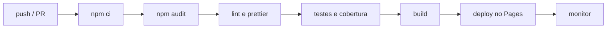

# Comparador de Produtos


Trabalho final da disciplina de Integração Contínua - UTFPR

**Aluno:** Gabriel Schmitt Teixeira - RA 2580527

Site publicado: https://saralapa.github.io/comparador-produtos/

## 1. Sobre o projeto

É uma SPA feita em React onde dá pra ver uma lista de celulares e notebooks e comparar até 3 deles lado a lado.
Os produtos são inventados e ficam num arquivo JSON, não tem backend.

O site em si é simples. A parte principal do trabalho é o processo em volta dele: CI, testes, qualidade, segurança, build, deploy e monitoramento.

## 2. Serviço proposto

Quem vai comprar um celular ou notebook geralmente abre várias abas pra comparar preço e configuração. A ideia é juntar isso numa página só, com a tabela de comparação já mostrando qual é o mais barato.

Público-alvo: pessoas pesquisando antes de comprar, que não entendem muito de especificação e querem ver tudo junto.

Possibilidades de monetização:

- espaço de anúncio no fim da página (hoje é só um bloco escrito "Anúncio")
- link de afiliado para as lojas, ganhando comissão quando alguém compra
- loja pagar para o produto aparecer como destaque

## 3. Funcionalidades

- lista de celulares e notebooks com preço, tela, memória, armazenamento, processador e nota
- busca pelo nome do produto
- filtro por categoria (todos, celulares ou notebooks)
- ordenar por menor ou maior preço
- mensagem quando a busca não encontra nenhum produto
- selecionar até 3 produtos e comparar numa tabela, com aviso se tentar marcar o quarto
- o mais barato fica destacado na comparação
- botão para limpar a comparação
- preço com separador de milhar (R$ 1.299,90)
- espaço de anúncio

## 4. Tecnologias utilizadas

- React 19 e Vite 8
- Vitest, Testing Library e coverage v8 nos testes
- ESLint e Prettier
- GitHub Actions para o CI, deploy, monitoramento e Docker
- CodeQL, Dependabot, npm audit, gitleaks e SonarCloud na parte de qualidade e segurança
- GitHub Pages para hospedar o site
- Docker (nginx) e GitHub Container Registry

## 5. Arquitetura da aplicação

Como é tudo no navegador, a arquitetura é só o React lendo um JSON:

```
src/
  App.jsx                 estado da tela (busca, categoria, ordem e selecionados)
  components/
    ListaProdutos.jsx     lista de cards
    CardProduto.jsx       um produto
    TabelaComparacao.jsx  tabela dos selecionados
    Anuncio.jsx           espaço de anúncio
  data/produtos.json      os produtos
  formatarPreco.js        formata o preço em reais
```

O `App.jsx` guarda o estado e passa os produtos filtrados para a lista e os selecionados para a tabela.
O JSON é importado direto no código, então ele vai junto no build e não precisa de servidor.

## 6. Estratégia de branches e versionamento

Usei uma versão simples do git flow:

- `main`: é o que está publicado no site. Só recebe PR vindo da `develop`.
- `develop`: onde as coisas prontas vão sendo juntadas.
- `feature/...`, `fix/...`, `ci/...` e `docs/...`: uma branch para cada coisa, criada a partir da `develop` e que volta para ela por pull request.

A `main` e a `develop` são protegidas: não dá pra fazer push direto, tem que abrir PR e os checks `build`, `gitleaks`, CodeQL (`analise (javascript-typescript)`) e SonarCloud precisam passar. A regra vale até para o dono do repositório.

Os PRs do Dependabot também entram pela `develop`.

Versões são marcadas com tag na `main` (vX.Y.Z). A `v0.1.0` foi o primeiro deploy no GitHub Pages.

## 7. Pipeline CI/CD

O pipeline é feito no GitHub Actions. Cada workflow fica em `.github/workflows`:

- `ci.yml`: roda em todo push e pull request na `main` e na `develop`. É o principal.
- `codeql.yml`: análise de segurança do código, nos mesmos eventos do CI e toda segunda de manhã.
- `deploy.yml`: roda quando entra coisa na `main` e publica o site.
- `monitor.yml`: verifica se o site está no ar (seção 13).
- `docker.yml`: monta a imagem Docker (seção 14).

Fluxo geral:



Etapas do `ci.yml`:

1. baixa o código e instala o Node 24
2. instala as dependências com `npm ci`
3. `npm audit` (dependência com falha de segurança alta ou crítica)
4. lint
5. confere a formatação com o Prettier
6. testes com cobertura
7. build
8. guarda o `dist` e o relatório de cobertura como artefatos

Tem também um job `gitleaks` que roda junto (seção 10).

Se qualquer passo falhar o job para ali e fica vermelho. Como a `main` e a `develop` exigem os checks, o PR fica bloqueado e não dá pra mesclar. Testei isso no PR #9, onde coloquei um teste errado: a execução falhou e o botão de merge ficou bloqueado.

Para ver uma execução: aba Actions do repositório, escolher o workflow e clicar na execução. Dá pra abrir cada passo e ver o log. No PR os checks aparecem embaixo, com link para a execução.

## 8. Testes automatizados

Os testes usam Vitest com Testing Library (o navegador é simulado com jsdom). São 31 testes em 7 arquivos, por exemplo:

- busca pelo nome, filtro por categoria e ordenar por preço
- mensagem de nenhum produto encontrado
- selecionar produtos, limite de 3 e limpar a comparação
- destaque do mais barato na tabela
- formatação do preço
- dados do JSON (todos com id diferente, preço maior que zero etc.)

A cobertura é medida com o coverage v8. No `vite.config.js` tem um mínimo de 90% (linhas, funções, branches e statements). Se ficar abaixo disso o `npm run test:coverage` falha e o CI para. Hoje está em 100%.

```bash
npm test
npm run test:coverage
```

O relatório de cobertura em HTML fica como artefato (`cobertura`) em cada execução do CI.

## 9. Qualidade de código

- ESLint: usa as regras recomendadas e as do React Hooks. O script `lint` roda com `--max-warnings 0`, então até aviso faz o CI falhar.
- Prettier: deixa todos os arquivos com a mesma formatação, assim o diff dos PRs não fica cheio de mudança só de espaço. No CI roda o `format:check`.
- SonarCloud: faz análise estática em todo push e PR, procurando bug, code smell e problema de segurança. O quality gate dele é um check obrigatório na `main` e na `develop`. Ele já reprovou PRs de verdade, por exemplo por causa de action sem versão fixa e do nginx rodando como root, e eu corrigi antes de mesclar.

O SonarCloud está com análise automática (configurada no site dele, sem token no repositório). Por isso a cobertura não aparece lá, ela é cobrada no CI pelo Vitest.

```bash
npm run lint
npm run format:check
```

## 10. Segurança

O que tem no pipeline e por que escolhi cada um:

SAST: CodeQL (`codeql.yml`). Ele analisa o código JavaScript e também os próprios workflows. Escolhi porque é do próprio GitHub, é grátis para repositório público e os alertas aparecem direto na aba Security. O check `analise (javascript-typescript)` é obrigatório para mesclar. O SonarCloud (seção 9) também aponta problemas de segurança.

Análise de dependências:

- `npm audit --audit-level=high` no CI e no deploy. Se alguma dependência tiver vulnerabilidade alta ou crítica o pipeline para.
- Dependabot (`.github/dependabot.yml`): toda semana abre PR na `develop` para atualizar os pacotes do npm e as versões das actions. Os alertas e as atualizações de segurança do Dependabot também estão ligados no repositório. Vários PRs dele já foram mesclados (por exemplo o #25 e o #26).

Secret scanning: o gitleaks roda no CI e no deploy olhando todo o histórico de commits, procurando senha ou token que tenha ido sem querer. Além dele deixei ligado o secret scanning do GitHub com push protection, que bloqueia o push se tiver um token conhecido. Usei os dois porque o gitleaks aparece como check no PR e o do GitHub barra antes do código chegar no repositório.

Cadeia de suprimentos:

- `npm ci` instala exatamente as versões do `package-lock.json`, e com `--ignore-scripts` não roda script de instalação dos pacotes (foi o SonarCloud que apontou isso)
- as actions de terceiros (gitleaks e as do docker) estão fixadas pelo SHA do commit, porque uma tag pode ser trocada pelo dono. O Dependabot atualiza esses SHAs
- os workflows começam com `permissions: contents: read` e só o job que precisa recebe mais permissão (CodeQL, deploy, monitor e docker)

Secrets e variáveis: não tem nenhuma senha ou token no código.

- `GITHUB_TOKEN`: o próprio Actions cria em cada execução. É usado pelo gitleaks, pelo monitor para abrir issue e pelo docker para publicar no ghcr.
- `vars.SITE_URL`: variável do repositório (Settings > Secrets and variables > Actions) com o endereço do site, usada pelo monitor.
- O SonarCloud usa análise automática, então não precisa de `SONAR_TOKEN`. Se um dia passar a rodar pelo CI, o token vai como secret, nunca no arquivo.

## 11. Build e artefatos

O build é feito pelo Vite com `npm run build`. Ele junta o React, os componentes e o JSON dos produtos em poucos arquivos dentro da pasta `dist`:

- `index.html`
- `assets/index-<hash>.js` (todo o código, já com os produtos)
- `assets/index-<hash>.css`
- `favicon.svg`

O hash no nome muda a cada build, assim o navegador não fica com versão velha em cache.

No pipeline o build é a última etapa do `ci.yml`, depois do audit, lint, formatação e testes. Se algo antes falhar, o build nem roda. No fim o `dist` é guardado como artefato `dist` na execução (dá pra baixar na página do run, em Artifacts), junto com o relatório de cobertura.

No deploy o `deploy.yml` faz o build de novo na `main` e envia o `dist` com o `actions/upload-pages-artifact`. Esse artefato (`github-pages`) é o que o `actions/deploy-pages` publica. Eu preferi fazer o build de novo no deploy em vez de baixar o do CI porque o CI roda em outro workflow, e assim o deploy usa exatamente o código da `main`.

Comando para gerar o build na máquina:

```bash
npm run build
npm run preview
```

## 12. Deploy

O site fica no GitHub Pages: https://saralapa.github.io/comparador-produtos/

O `deploy.yml` roda em todo push na `main` (ou seja, quando um PR da `develop` é mesclado). Os jobs são:

1. `validar`: audit, lint, formatação e testes com cobertura
2. `gitleaks`
3. `build`: só roda se os dois anteriores passarem
4. `deploy`: publica no Pages

Então uma versão com teste quebrado ou com segredo no código não chega no site. O `vite.config.js` tem `base: '/comparador-produtos/'` porque no Pages o site fica dentro do nome do repositório.

## 13. Monitoramento e observabilidade

O `monitor.yml` verifica se o site publicado continua no ar. Ele roda:

- a cada 6 horas (cron)
- depois de cada execução do Deploy
- manualmente pelo botão Run workflow

Ele faz um `curl` na URL do site (que vem da variável `SITE_URL`) e considera que está no ar se a resposta for HTTP 200 e a página tiver o texto "Comparador de Produtos". Se não der, espera 20 segundos e tenta de novo, até 3 vezes. Se as 3 falharem o job fica vermelho e abre uma issue "Site fora do ar" com o link da execução (se já tiver uma aberta, só comenta nela).

O resultado de cada verificação fica no histórico do Actions, no workflow Monitor, com o status de cada tentativa no log.

A diferença para o CI/CD: o CI e o deploy verificam se uma versão nova pode ser publicada. O monitor verifica se a versão que já está publicada continua funcionando, mesmo sem ninguém mexer no código.

## 14. Docker (opcional)

O `Dockerfile` tem duas etapas: primeiro usa o `node:24-alpine` para instalar as dependências e fazer o build, depois copia só o `dist` para um nginx. A imagem do nginx é a `nginx-unprivileged`, que não roda como root (o SonarCloud reclamou do nginx normal), por isso a porta é 8080.

O `docker.yml` roda os testes antes e depois monta a imagem:

- em PR: só monta, para ver se o Dockerfile funciona
- na `main`: publica `ghcr.io/saralapa/comparador-produtos:latest`
- em tag `v*`: publica também com o número da versão

A publicação usa o `GITHUB_TOKEN` (permissão `packages: write` só nesse job). A imagem é pública:

```bash
docker run -p 8080:8080 ghcr.io/saralapa/comparador-produtos:latest
```

Depois é só abrir http://localhost:8080

## Como rodar na máquina

Precisa do Node 24.

```bash
npm install
npm run dev
```
